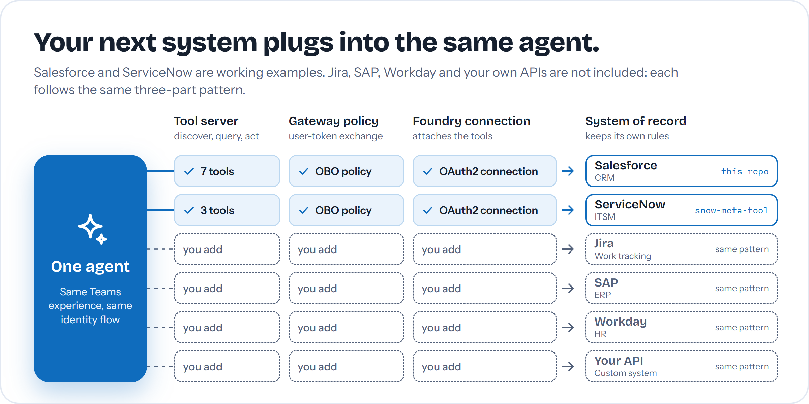
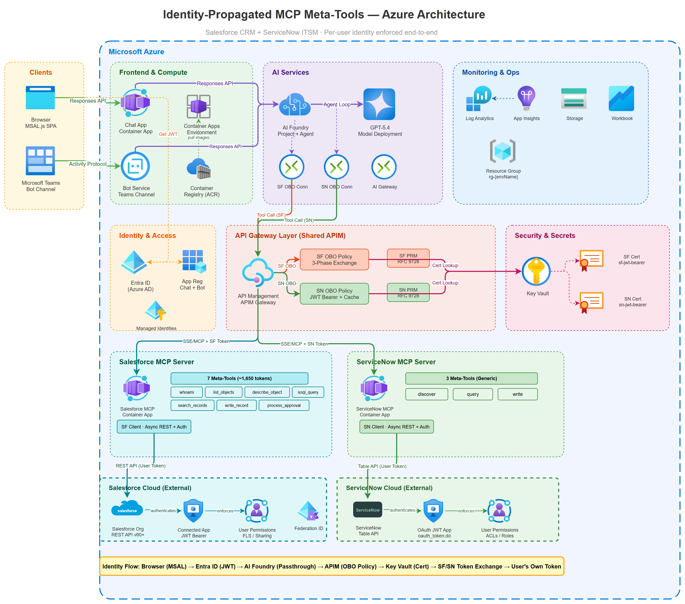
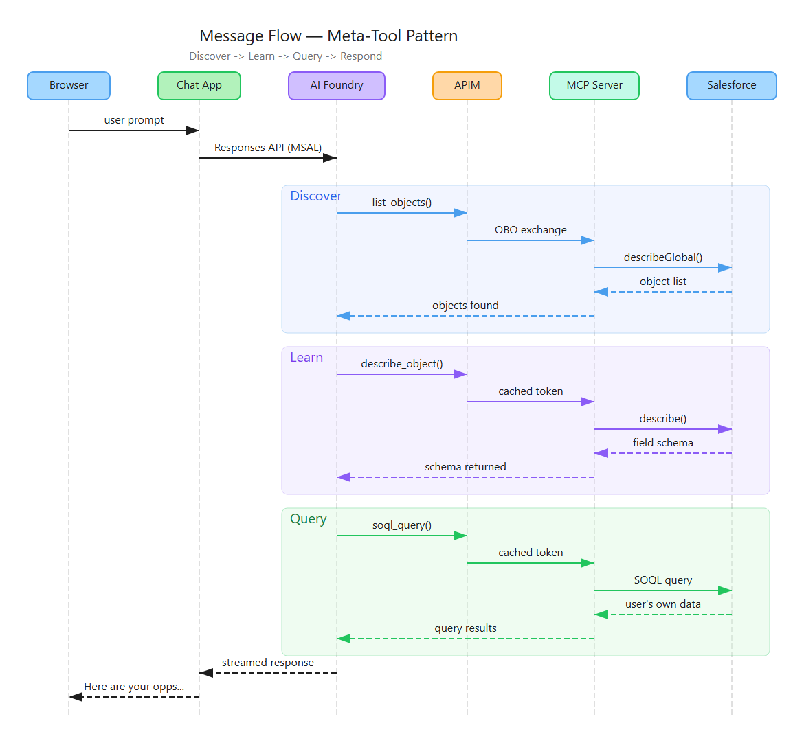
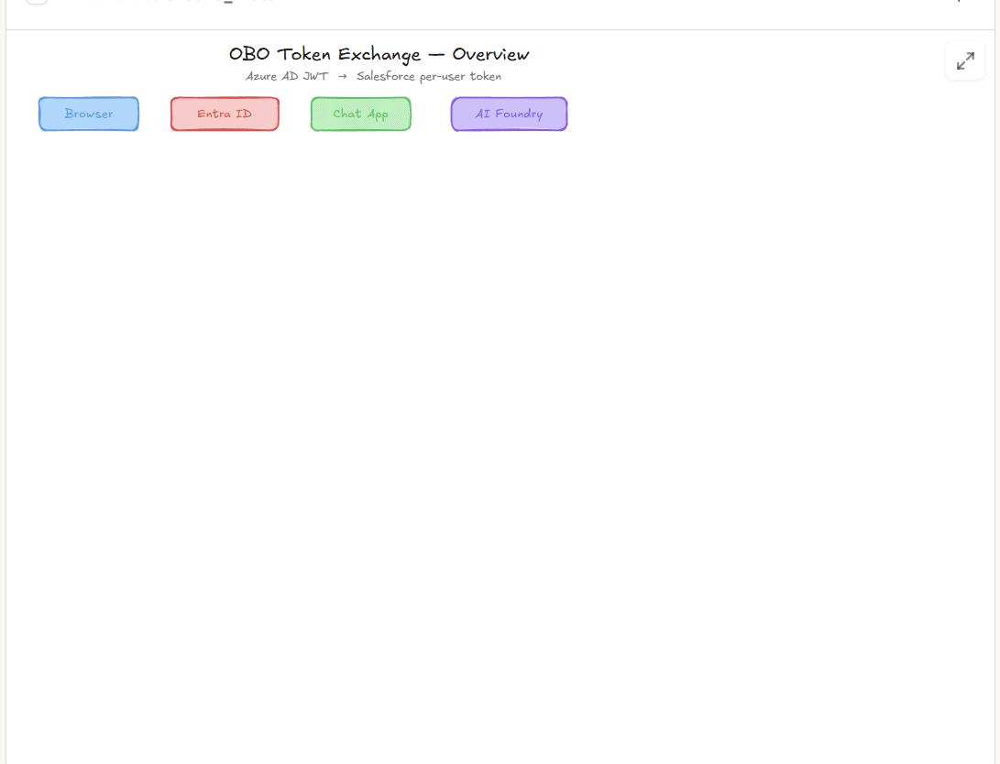
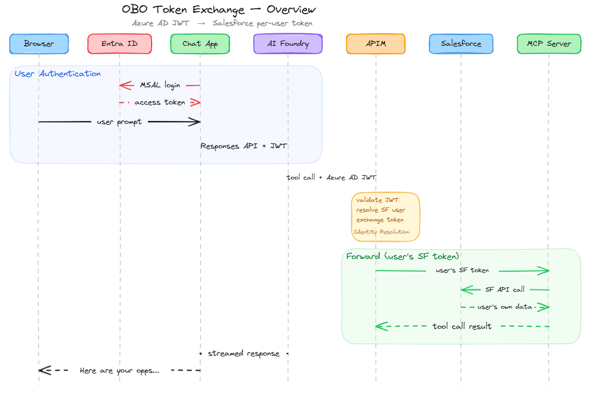

# Build the engagement layer once. Let one agent act across all your systems of record.

[](LICENSE)
[](https://learn.microsoft.com/azure/developer/azure-developer-cli/)
[](https://www.python.org/)
[](https://ozgurkarahan.com/customer-360/)

**Customer 360 Assistant** is an open-source reference implementation built on Microsoft Teams, Microsoft Foundry and Azure API Management. People ask in Teams. One Foundry agent routes each request to the right tool. In this sample that means Salesforce and ServiceNow; Jira, SAP, Workday or your own APIs follow the same pattern. **Every action runs as the signed-in user, with their own permissions in each system.**

**[▶ Watch the 2:40 story](#see-it-in-action-240)** · **[Project page](https://ozgurkarahan.com/customer-360/)** · **[Deploy it](#deployment-and-setup)** · **[Read the architecture story](https://www.linkedin.com/pulse/from-theory-production-salesforce-meta-tools-identity-ozgur-karahan-ch30e/)**

<p align="center">
  
</p>

## See It in Action (2:40)

Alice, an account manager, has five minutes before a call with Contoso. In a Teams group chat she gets a 360° view across Salesforce and ServiceNow. After the call, she updates the CRM in one sentence. Every action runs as Alice.

https://github.com/user-attachments/assets/82847835-87b0-42e4-9bb8-fa39cc140551

> Animated mock-ups with demo data (Contoso, Alice, Bob). Source and render instructions: [video/](video/README.md). Consent is designed to happen once per system; a current Foundry platform issue can ask users to consent again after about an hour ([known issue](CHANGELOG.md#known-issues-platform-not-fixable-in-this-repo)).

## One Agent Between Your People and Your Systems

| Layer | You build it | What it does |
|---|---|---|
| **Engagement layer** | Once | Teams 1:1 and group chats, Microsoft 365 Copilot through Foundry publishing, and a web chat. People stay in the tools they already use. |
| **One agent** | Once | A Microsoft Foundry agent understands the request, picks the tools, correlates answers across systems and drafts the update. |
| **Identity gateway and tools** | Once per system of record | Each system gets a tool server behind Azure API Management. The gateway swaps the user's sign-in for that same user's token in the system. |

The thread through every layer is the user's identity. People sign in once with Microsoft Entra ID, and every tool call carries that identity.

## Why It Matters

- **Meets people where they work.** The assistant lives in Teams chats and, through Foundry publishing, in Microsoft 365 Copilot. There is no new portal to learn.
- **One agent, many systems.** Adding a system of record means adding a tool server, a gateway policy and a connection. The agent and the Teams experience stay the same.
- **Acts as the user, never as a super-user.** Operations in each system run with the user's own token, so Salesforce sharing rules, field-level security and ServiceNow ACLs apply exactly as they do today.
- **Accountable by design.** Writes show the real person in native audit fields such as *Last Modified By*, and each per-user token exchange appears in Salesforce Login History.
- **Broad reach, small toolset.** Seven generic tools let the agent discover, at runtime, the objects and fields the user can see, standard and custom alike. A new custom object needs no new code.
- **Open standards, automated deployment.** MCP, OAuth 2.0 and OpenID Connect, with a [documented path](docs/deepdive.md#idp-flexibility) to other identity providers such as Okta or PingFederate. Bicep and `azd` deploy the stack once the prerequisites are in place.

## What People Ask

| Moment | Ask the assistant | Systems |
|---|---|---|
| Before a customer call | *"Prepare me for my QBR with Acme Corp. Pull everything from both systems."* | Salesforce + ServiceNow |
| Account review | *"Give me a Customer 360 view for Contoso Ltd."* | Salesforce + ServiceNow |
| Incident triage | *"We have a P1 incident about API gateway failures. Which accounts and open opportunities are affected?"* | ServiceNow → Salesforce |
| Change planning | *"We're planning a billing upgrade on Saturday. Check the change request and the accounts with upcoming renewals."* | ServiceNow → Salesforce |
| After the call | *"Add a note on the Contoso Analytics Add-on opportunity: the customer wants a POC first. Move the close date to next quarter."* | Salesforce (write, as the user) |

> Adapted from [docs/TEST_PROMPTS_360.md](docs/TEST_PROMPTS_360.md), which run against [seeded demo data](docs/DEMO_DATA_SETUP.md). Every prompt runs with the asker's own access; the last one is the CRM update shown in the video.

## Acts as the User, Never as a Super-User

<p align="center">
  
</p>

1. **Sign in once.** Alice signs in to Teams with her work account (Microsoft Entra ID).
2. **Consent once per system, by design.** Standard OAuth consent happens the first time the agent reaches a system; a [known platform issue](CHANGELOG.md#known-issues-platform-not-fixable-in-this-repo) can ask again after about an hour.
3. **The gateway swaps the token.** Azure API Management validates Alice's token, finds her account in each system, and gets a token issued to Alice.
4. **Each system applies its own rules.** Sharing rules, field-level security and ACLs decide what Alice can see and change.
5. **Writes carry her name.** The record shows *Last modified by: Alice*, not an integration user.

No shared credential touches business data. A minimal-access service account only maps Alice to her Salesforce user. Identity propagation stops privilege escalation, but it cannot stop an agent from misreading intent, so keep confirmations for destructive actions ([what it does not protect against](docs/deepdive.md#what-it-does-not-protect-against)).

## Built to Grow: Plug In Your Next System

<p align="center">
  
</p>

Salesforce and ServiceNow are working examples. Every system follows the same three-part pattern:

- a **tool server** that discovers, queries and acts on the system,
- a **gateway policy** that exchanges the user's token for a token in that system,
- a **Foundry connection** that attaches the tools to the agent.

Jira, SAP, Workday and your own APIs are **not included** in this repository; they are where the pattern goes next.

**Why meta-tools instead of one tool per object?** Many MCP servers define one tool per object, so every new object means new code and a longer tool list. A meta-tool server works like a shell: the agent discovers objects, learns their fields and builds the query itself, with the user's own access. The tool list stays the same whatever the size of the org. See [the meta-tool pattern](docs/deepdive.md#the-meta-tool-pattern).

## What's in the Box

**In this repository**

- **Salesforce meta-tool server:** 7 tools (`whoami`, `list_objects`, `describe_object`, `soql_query`, `search_records`, `write_record`, `process_approval`) on Azure Container Apps.
- **Identity gateway:** Azure API Management policies for the three-phase on-behalf-of (OBO) exchange.
- **Foundry agents:** `salesforce-assistant` and `customer360-assistant`, wired through OAuth2 identity-passthrough connections. Their behaviour comes from six versioned [Foundry skills](skills/) (`salesforce-crm`, `servicenow-itsm`, `customer360-correlation`, `revenue-at-risk`, `meeting-prep`, `change-risk`), with a lean system prompt on top.
- **Engagement:** a web chat app (MSAL.js), a Teams app published to your org catalog, and Microsoft 365 Copilot through [Foundry publishing](docs/teams-integration.md).
- **Delivery:** Bicep and `azd`, Salesforce org setup scripts, demo-data seeding and E2E tests.

**The two-repo Customer 360 demo** adds [snow-meta-tool](https://github.com/ozgurkarahan/snow-meta-tool) (ServiceNow tools, same pattern) and correlated demo data ([setup](docs/DEMO_DATA_SETUP.md)).

> [!NOTE]
> This is a reference implementation with demo data, not an audited production product. Read the [current scope and limitations](docs/deepdive.md#current-scope-and-limitations) and the [known platform issues](CHANGELOG.md#known-issues-platform-not-fixable-in-this-repo) before you adapt it.

---

## For Architects and Developers

The rest of this page is the technical path: architecture, identity flow, tools and deployment.

### Architecture



> [draw.io source](docs/diagrams/azure-architecture.drawio)

### How It Works

The user asks a question. The agent discovers objects, learns schemas, and queries Salesforce — all through the same seven tools, all with the user's own identity.

<table><tr>
<td></td>
<td></td>
</tr></table>

> [Excalidraw source](docs/diagrams/message-flow-sequence.excalidraw)

### On-Behalf-Of (OBO) Token Exchange

APIM handles a three-phase exchange: validate the Azure AD JWT, resolve the Salesforce username, and acquire a per-user Salesforce token. The MCP server never sees Azure AD credentials. Foundry obtains the user's delegated token through an OAuth2 identity-passthrough connection against a customer-owned Entra app (one-time consent per user) — Agent Service [no longer forwards Microsoft-audience tokens](https://learn.microsoft.com/azure/foundry/agents/how-to/mcp-authentication#oauth-identity-passthrough) to custom MCP endpoints.

<table><tr>
<td></td>
<td></td>
</tr></table>

> **Deep dive:** [Detailed OBO exchange animation](docs/diagrams/obo-token-exchange.gif) | [Full detail PNG](docs/diagrams/obo-token-exchange.png) | [Excalidraw source](docs/diagrams/obo-token-exchange.excalidraw)

> **v2 (2026-07): OAuth2 identity passthrough.** Foundry Agent Service [blocks Microsoft-audience tokens to custom MCP endpoints](https://learn.microsoft.com/azure/foundry/agents/how-to/mcp-authentication#oauth-identity-passthrough) (`Cannot pass Microsoft token to untrusted MCP endpoint`), which ended the original `UserEntraToken` connection. v2 uses an OAuth2 identity-passthrough connection backed by your own Entra app: one-time consent per user, same three-phase OBO exchange. Rationale and migration: [CHANGELOG.md](CHANGELOG.md).

### The 7 Tools

| Tool | What it does |
|------|--------------|
| `whoami` | Resolve the current user's identity from the bearer token |
| `list_objects` | Discover objects (1000+ in a typical org), filter by name/label |
| `describe_object` | Field schemas, types, required flags, picklists, external IDs |
| `soql_query` | Full SOQL: relationships, aggregates, GROUP BY, auto-pagination |
| `search_records` | SOSL full-text search across multiple objects simultaneously |
| `write_record` | Create, update, upsert (by external ID), delete |
| `process_approval` | Submit, approve, reject via Salesforce approval workflows |

The seven tool definitions come to roughly 1.65K tokens per model call (about 2.1K with the server instructions), whatever the size of the org. Measured from the server's `tools/list` with the o200k_base tokenizer (October 2026); details in [docs/deepdive.md](docs/deepdive.md#why-this-scales). Field schemas are loaded on demand through `describe_object` rather than pre-loaded into the system prompt.

### Skills and Publishing (v3)

- **Skills:** each `skills/<name>/SKILL.md` becomes a Foundry skill version. `azd up` uploads a new version only when the content changes, and the agents pin exact versions. Prompt agents can't load skills at runtime yet, so the hook compiles the pinned versions into the instructions (`SKILLS_MODE=inline`). `SKILLS_MODE=native` is ready for when the GitHub Copilot harness is available. See [AGENT.md](AGENT.md#skills-v3).
- **One toolbox (opt-in):** `azd env set C360_TOOLS_MODE toolbox` serves Customer 360 from a single Foundry Toolbox that holds both MCP servers and all skills.
- **Staged publish:** every agent version gets its own deployment. The hook smoke-tests it before it receives Teams traffic, and `python hooks/postprovision.py --rollback` restores the previous version.
- **E2E:** `python scripts/test_e2e_customer360.py [--path version|app]` runs one or more turns per skill plus a write guard.

### Deep Dive

For detailed technical explanations, see [docs/deepdive.md](docs/deepdive.md):

- [**The Meta-Tool Pattern**](docs/deepdive.md#the-meta-tool-pattern) — Why seven tools beat one-per-object, with token cost comparison
- [**Tool Reference**](docs/deepdive.md#tool-reference) — Per-tool descriptions with Unix analogies
- [**Identity Propagation: End-to-End**](docs/deepdive.md#identity-propagation-end-to-end) — Architecture, hop-by-hop token trace, caching layers, key guarantees
- [**IdP Flexibility**](docs/deepdive.md#idp-flexibility) — How to swap Azure AD for Okta, PingFed, or another OIDC provider
- [**Current Scope and Limitations**](docs/deepdive.md#current-scope-and-limitations) — Production considerations
- [**Diagram Sources**](docs/deepdive.md#diagram-sources) — Mermaid sources for both sequence diagrams

## Deployment and Setup

> **New to this project?** Follow the [step-by-step installation guide](docs/installation.md)
> for a complete walkthrough from a clean Azure subscription and Salesforce org.

### Prerequisites

You need an Azure subscription (Contributor + User Access Administrator), a Salesforce Developer or Sandbox org, and the Azure Developer CLI, Azure CLI, Python 3.11+, Docker Desktop, the Salesforce CLI and OpenSSL. Versions and links are in [Phase 0 of the installation guide](docs/installation.md#phase-0-prerequisites).

### Quick Deploy

If you already have a configured Salesforce org and certificate:

```bash
git clone https://github.com/ozgurkarahan/salesforce-meta-tool-identity-propagation.git
cd salesforce-meta-tool-identity-propagation
pip install -r requirements.txt

azd env new obo
azd env set SF_INSTANCE_URL "https://your-org.my.salesforce.com"
azd env set SF_CONNECTED_APP_CLIENT_ID "<connected-app-consumer-key>"
azd env set SF_SERVICE_ACCOUNT_USERNAME "<svc@your-org.my.salesforce.com>"

# v2: Entra app backing the OAuth2 identity-passthrough connection
# (create it first -- see docs/installation.md Phase 3)
azd env set MCP_OAUTH_CLIENT_ID "<mcp-oauth-app-id>"
azd env set MCP_OAUTH_CLIENT_SECRET "<mcp-oauth-app-secret>"

azd up
```

The postprovision hook automatically uploads `certs/sf-jwt-bearer.pfx` to Key Vault, creates the APIM certificate binding, and sets `SF_JWT_BEARER_CERT_THUMBPRINT`. No manual thumbprint step needed.

After `azd up` completes, open the Chat App URL printed at the end. Sign in with your Azure AD account and send a message (e.g., *"Show me my Salesforce accounts"*).

### From Scratch

1. **Generate certificate** — see [installation guide Phase 1](docs/installation.md#phase-1-generate-x509-certificate)
2. **Salesforce setup** — see [installation guide Phase 2](docs/installation.md#phase-2-salesforce-org-setup)
3. **Set environment variables** (5 vars — no thumbprint needed):
   ```bash
   azd env set SF_INSTANCE_URL "https://your-org.my.salesforce.com"
   azd env set SF_CONNECTED_APP_CLIENT_ID "<consumer-key>"
   azd env set SF_SERVICE_ACCOUNT_USERNAME "<svc@your-org.my.salesforce.com>"
   azd env set MCP_OAUTH_CLIENT_ID "<mcp-oauth-app-id>"       # v2 -- see installation guide Phase 3
   azd env set MCP_OAUTH_CLIENT_SECRET "<mcp-oauth-app-secret>"
   ```
4. **Deploy:** `azd up`
5. **Map user identities** — see [installation guide Phase 4](docs/installation.md#phase-4-map-user-identities)

### Environment Variables

The full table moved to the installation guide: [Reference: Environment Variables](docs/installation.md#reference-environment-variables).

### Project Structure

The annotated tree moved to the installation guide: [Reference: Project Structure](docs/installation.md#reference-project-structure).

### Common Issues

Troubleshooting moved to the installation guide: [Common Issues](docs/installation.md#common-issues). That section also covers the v2 consent and token-expiry issues.

---

## Related Projects

This repository is part of the **Identity Propagation series** on end-to-end user identity for AI agents: no shared service account reading or writing business data, and every action traceable to a real user. Read the story: [From Theory to Production: Salesforce Meta-Tool & Identity Propagation](https://www.linkedin.com/pulse/from-theory-production-salesforce-meta-tools-identity-ozgur-karahan-ch30e/).

- **[snow-meta-tool](https://github.com/ozgurkarahan/snow-meta-tool)** — The ServiceNow counterpart: the same meta-tool pattern and OBO identity propagation, applied to ServiceNow ITSM. Deploy both side by side to power the **Customer 360** Foundry agent, which correlates Salesforce CRM data with ServiceNow incidents, changes and requests under the user's own identity in each system.
- **[propagate-id-entra](https://github.com/ozgurkarahan/propagate-id-entra)** — An Entra ID identity-flow proof of concept in the same series.

## Contributing

Contributions are welcome. Please open an [issue](https://github.com/ozgurkarahan/salesforce-meta-tool-identity-propagation/issues) or submit a pull request.

This project uses `azd` for deployment. See [Deployment and Setup](#deployment-and-setup) to get a local environment running.

---

## License

[MIT License](LICENSE)

---

*Related article: [The Meta-Tool Pattern Applied to Enterprise](https://www.linkedin.com/pulse/billion-dollar-agent-loop-ozgur-karahan-fszae/) on LinkedIn.*
